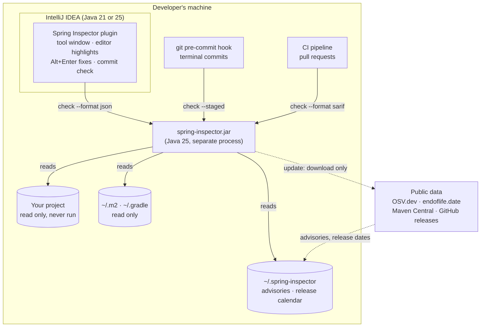
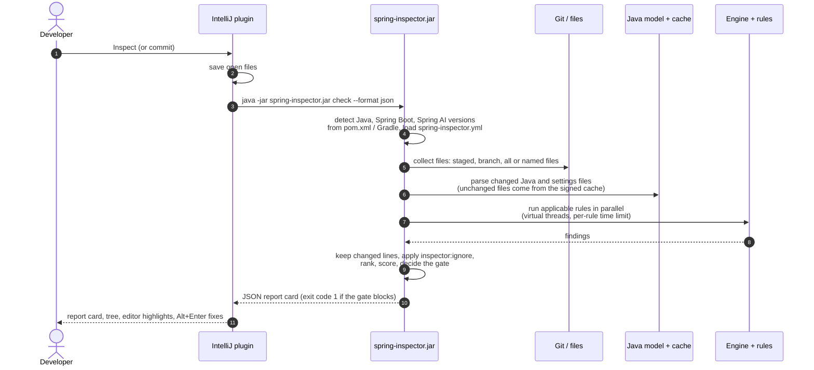
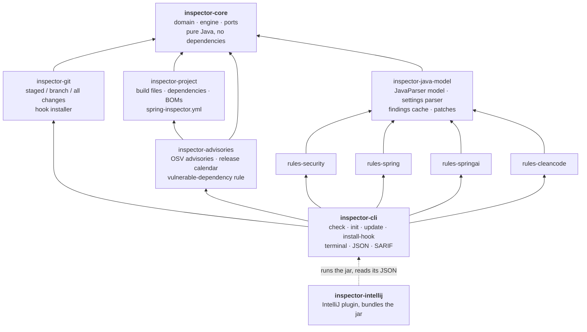
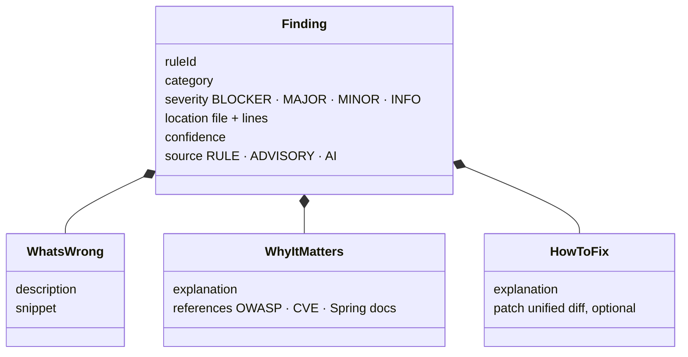
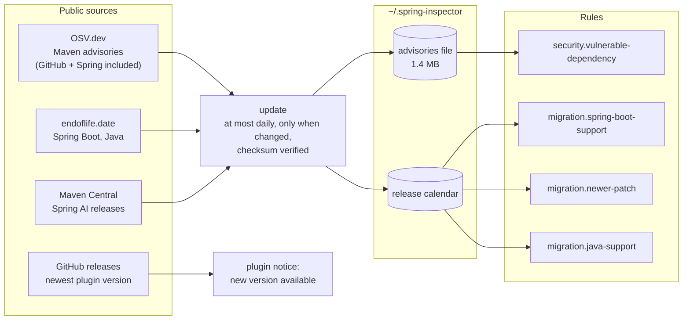

# Architecture

How Spring Inspector works, from a click in IntelliJ to a finding with a fix. The decisions behind it are recorded in
the [architecture decision records](adr/README.md).

- [The big picture](#the-big-picture)
- [One inspection, step by step](#one-inspection-step-by-step)
- [Modules](#modules)
- [A finding and its fix](#a-finding-and-its-fix)
- [Staying current](#staying-current)
- [Safety by design](#safety-by-design)

## The big picture

Everything runs on the developer's machine. The only network traffic is downloading public data: vulnerability
advisories, release dates and the newest version number. Nothing about the inspected project is ever sent.

**The plugin does not inspect code itself.** It starts the same `spring-inspector.jar` that the command line and the
git hook use, in its own process, and reads its JSON report ([ADR-0004](adr/0004-intellij-plugin.md)). That gives
three guarantees:

- the IDE, the git hook and CI always report exactly the same findings;
- a slow or failing inspection can never freeze or crash the IDE;
- the plugin runs on the IDE's Java (21 in 2025.x IDEs), while the inspector uses Java 25.

## One inspection, step by step

1. **Detect the project** (`inspector-project`): versions and modules come from the build files, which are read but
   never run. Per-project settings come from `spring-inspector.yml`.
2. **Collect what to inspect** (`inspector-git`): staged changes (`--staged`), changes since a branch
   (`--base main`), every file (`--all`, also outside git) or named files (`--files`).
3. **Parse** (`inspector-java-model`): JavaParser with type resolution turns Java files into a model rules can query;
   `application*.yml` and `.properties` files are parsed with their profiles
   ([ADR-0001](adr/0001-semantic-model-javaparser.md)). Results are cached per file and signed with a key kept
   outside the repository ([ADR-0002](adr/0002-findings-cache.md)).
4. **Run rules** (`inspector-core`): each rule is a plugin implementing the `Check` interface. Rules that do not
   apply to the project's versions are skipped, and rules never call each other.
5. **Report**: findings on the changed lines are kept, suppressions with a reason are honoured, and the score and
   gate decide whether a commit is blocked. Output is terminal text, JSON (for the plugin) or SARIF (for GitHub code
   scanning).

## Modules

The design is hexagonal: the core knows nothing about frameworks, files, git, HTTP or the IDE, and every adapter
depends on the core, never the other way round. ArchUnit tests enforce this on every build.

| Module | Responsibility |
|--------|----------------|
| `inspector-core` | Findings, report card, release calendar, the engine (selection, parallel runs, suppressions, scoring, gate) and the ports `Check`, `SourceProvider`, `ReportRenderer` |
| `inspector-java-model` | The semantic model of Java and settings files that rules query, the signed findings cache, patch building |
| `inspector-project` | Detects versions and modules; resolves dependencies through properties, parents, BOMs and built jars |
| `inspector-git` | Collects changes with JGit; inspects plain folders; installs the pre-commit hook |
| `inspector-advisories` | Downloads and stores OSV advisories and the release calendar; the vulnerable-dependency rule |
| `inspector-rules-*` | The 58 rules, one class each, registered through `META-INF/services`; `inspector-rules-architecture` also recognises architecture styles and writes the architecture report |
| `inspector-rule-testkit` | Runs a rule on code snippets in tests, including applying its patch |
| `inspector-cli` | The `spring-inspector.jar` entry point and its output formats |
| `inspector-intellij` | The IntelliJ plugin (a separate Gradle build) |

Adding a rule means writing one `Check` class, registering it and testing it with the test kit; neither the engine
nor any other rule changes.

## A finding and its fix

Every rule answers the same three questions, and many attach a patch.

In IntelliJ, **Alt+Enter → Apply Spring Inspector fix** previews that patch and applies it only if every line it
touches is still as it was when the inspection ran; otherwise it refuses, so a fix is never applied in the wrong
place.

## Staying current

Facts that change over time are data, downloaded as the world changes; rule logic arrives with new versions.

| What changes | How users get it | New plugin version needed? |
|--------------|------------------|----------------------------|
| A new vulnerability advisory | The plugin and the git hook refresh advisories daily | No |
| A Spring Boot or Java line leaves support | The release calendar's dates; warnings start three months ahead | No |
| A new Spring Boot or Spring AI patch release | `migration.newer-patch` names it | No |
| New APIs that need new rules | A weekly [release watch](../.github/workflows/release-watch.yml) opens an issue for the maintainers; the plugin then announces the new version | Yes |

Dependency versions are found without running the build: from `pom.xml` and Gradle files, from parents and BOMs
already in the local Maven or Gradle cache, and from the libraries inside a jar or war the project has built
([ADR-0003](adr/0003-advisory-database-file.md)).

## Safety by design

- **The inspected code is data.** It is parsed, never compiled or run; the build is never executed; instructions
  written inside the code are never followed.
- **Local by default.** No account, no server, no telemetry; only public data is downloaded, and each automatic
  download can be switched off.
- **Untrusted input is bounded.** Downloaded archives, built jars and build files are read with size and count
  limits; XML is parsed without external entities.
- **Integrity.** The findings cache is signed with a per-user key kept outside the repository; downloaded advisories
  are checked against their published checksum.
- **Careful edits.** Paths from reports and patches must stay inside the project, text from the code is escaped
  before the plugin shows it, and patches apply only to unchanged code.
